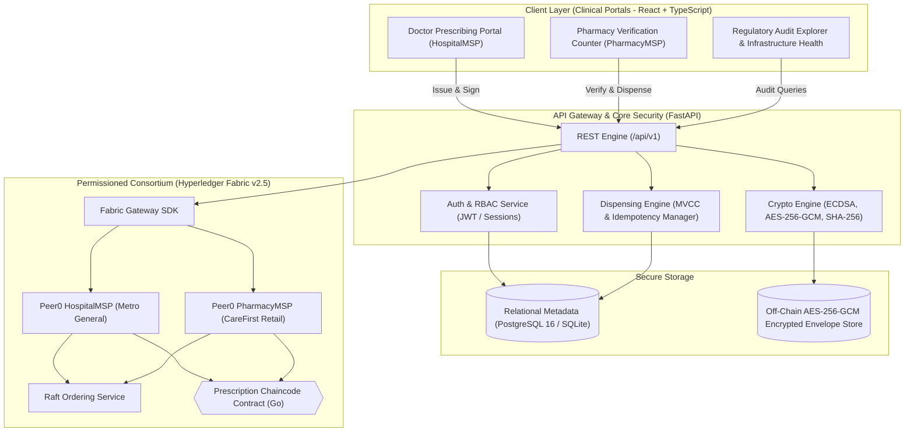

# RxGuard: A Blockchain-Based Prescription Verification and Dispensing System

[](https://opensource.org/licenses/MIT)
[](https://fastapi.tiangolo.com)
[](https://react.dev)
[](https://www.typescriptlang.org/)
[](https://www.hyperledger.org/projects/fabric)
[](https://tailwindcss.com)

**RxGuard** is an enterprise-grade healthcare security and trust infrastructure platform designed to eliminate prescription fraud, illicit dosage alteration, and duplicate cross-pharmacy dispensing using permissioned blockchain consensus and public-key cryptography.

---

##  Foundational Architectural Invariant: Zero On-Chain PHI

> **Core Healthcare Privacy Principle:** Blockchain is strictly the shared verification, state machine, and tamper-evident audit layer — **NOT a database for storing private patient health records (PHI).**
>
> All clinical records, patient demographics, and diagnostic regimens remain strictly **off-chain**, encrypted at rest using **AES-256-GCM** authenticated encryption with unique 96-bit nonces. Only opaque UUID references, canonical SHA-256 payload hashes, doctor public key signatures, and authorized pill counts are anchored to the permissioned **Hyperledger Fabric** ledger (`rxguardchannel`).

---

##  Project Team & Academic Record

**Presidency University, Bengaluru**  
**School of Computer Science and Engineering | B.Tech CSE (Academic Year 2026–2027)**

| Name | University Seat Number (USN) | Role / Core Responsibilities |
| :--- | :--- | :--- |
| **Ravichandra Nayakar H** | `20241CSE0987` | Lead Architect & Security Engineering |
| **Hemanth V** | `20241CSE1000` | Blockchain & Smart Contracts (Chaincode) |
| **Vikas H N** | `20241CSE1011` | Backend REST API & Relational Database |
| **Mohan Kumar A** | `20241CSE0977` | Frontend Engineering & Clinical UI/UX |
| **Pavan Kumar N** | `20241CSE0968` | Cryptographic Protocols & Serialization |
| **Yashwanth DD** | `20241CSE1020` | QA, Concurrency & MVCC Testing |

---

##  Clinical Problem vs. RxGuard Solution

| Problem in Traditional Healthcare | How RxGuard Solves It |
| :--- | :--- |
| **Paper Prescription Forgery:** Criminals forge doctor letterheads, stamps, and signatures. | **ECDSA SECP256R1 Digital Signatures:** Every prescription is cryptographically signed by the doctor's enrolled private key on `HospitalMSP`. |
| **Dosage Tampering:** Altering `10` pills to `40` pills on a paper or unverified PDF pass. | **Canonical SHA-256 Hashing:** If a single letter or quantity is altered, the calculated hash mismatches the ledger anchor, triggering an immediate security freeze. |
| **Double-Dispensing & Doctor Shopping:** Taking the same prescription to multiple pharmacies to get double pills. | **Atomic MVCC Ledger Balance:** The blockchain acts as a synchronized state counter. When Pharmacy A dispenses 15 pills, remaining balance decrements to 15 across the entire network in real-time. |
| **HIPAA / Data Leak Risks:** Public blockchains expose sensitive medical records. | **Off-Chain AES-256-GCM Encryption:** Plaintext clinical details are never published to the ledger. |

---

##  Strict Role-Based Access Control (RBAC) Architecture

RxGuard enforces strict separation of clinical duties across independent consortium organizations:

```
┌────────────────────────────────────────┐       ┌────────────────────────────────────────┐
│  Dr. Sarah Smith, MD (HospitalMSP)     │       │  Marcus Vance, PharmD (PharmacyMSP)    │
│  Metro General Hospital                │       │  CareFirst Retail Pharmacy Network     │
├────────────────────────────────────────┤       ├────────────────────────────────────────┤
│  ✅ Allowed:                           │       │  ✅ Allowed:                           │
│  • Diagnose Patients                   │       │  • Scan / Paste Patient QR Tokens      │
│  • Author Medication Regimens          │       │  • Execute Cryptographic Audit         │
│  • Sign with ECDSA Private Key         │       │  • Verify Remaining Ledger Balance     │
│  • Generate Scannable QR Passes        │       │  • Commit Atomic Dispense Operation    │
│                                        │       │                                        │
│  ⛔ Strictly Restricted:               │       │  ⛔ Strictly Restricted:               │
│  • CANNOT dispense pharmacy inventory  │       │  • CANNOT create prescriptions         │
│  • CANNOT record dispense transactions │       │  • CANNOT alter patient records        │
└────────────────────────────────────────┘       └────────────────────────────────────────┘
```

---

##  System Architecture Topology



---

## Workstation Screens & Features

### 1. Physician Portal (Doctor Workspace)
* **Prescriber Identity:** Connected as `Dr. Sarah Smith, MD` under `HospitalMSP`.
* **Patient Demographics:** Enters Patient Reference ID, Full Legal Name, and Date of Birth.
* **Medication Regimen:** Multi-medication row builder with National Drug Codes (NDC), dosages, units authorized, and frequency instructions.
* **Cryptographic Issuance:** Produces canonical JSON, hashes with SHA-256, signs with ECDSA private key (`SECP256R1`), and commits to the ledger.
* **Prescription Medical Pass:** Generates a downloadable `.png` official medical pass with hospital seals, scannable QR code, and one-click token copy.

### 2. Pharmacy Counter (Dispensary Terminal)
* **Dispensary Identity:** Connected as `Marcus Vance, PharmD` under `PharmacyMSP`.
* **QR Token Verification:** Scans or pastes patient verification token (`RXG-XXXX-TOKEN`).
* **Fraud & Tamper Defense:** If an invalid, wrong, or tampered token is entered, displays an immediate red **`SECURITY REJECTION: DISPENSE LOCKED`** alert.
* **Cryptographic Verification:** Validates Dr. Sarah's signature against `HospitalMSP`, confirms expiry, and retrieves the authoritative remaining balance.
* **Atomic Dispensing:** Supports partial and full refills (e.g., dispensing 15 of 30 authorized pills). Uses Multi-Version Concurrency Control (MVCC) to prevent race conditions.

### 3. Clinical Overview (Telemetry Dashboard)
* Real-time metrics tracking: Total registered prescriptions, authenticity checks completed, atomic dispense operations, and tamper incidents blocked.
* Explains active cryptographic invariants: ECDSA signatures, AES-256-GCM off-chain privacy, and MVCC atomic balance locks.

### 4. Regulatory Audit Log
* Immutable regulatory interface for healthcare oversight bodies (DEA, FDA, Ministry of Health).
* Displays chronological ledger audit records with timestamps, actor IDs, organization MSPs, transaction hashes, and forensic outcomes.

### 5. Network Infrastructure
* Component monitoring for Hyperledger Fabric peers (`peer0.hospital`, `peer0.pharmacy`), Raft consensus orderer, off-chain encrypted filesystem, and FastAPI REST gateway.

---

## 🚀 Quick Start Guide

### Option 1: Docker Compose (All-in-One Containerized)

```powershell
# 1. Clone repository
git clone https://github.com/RavichandraNayakar/RxGuard.git
cd RxGuard

# 2. Copy environment template
Copy-Item .env.example .env

# 3. Launch PostgreSQL, Backend, and Frontend containers
docker compose up --build
```

### Option 2: Local Development Execution

#### 1. Backend (FastAPI + Python 3.11+)
```powershell
cd backend
python -m venv venv
.\venv\Scripts\Activate.ps1
pip install -r requirements.txt
uvicorn app.main:app --host 0.0.0.0 --port 8000 --reload
```

#### 2. Frontend (React + Vite + Tailwind CSS)
```powershell
cd frontend
npm install
npm run dev
```

---

##  Access Endpoints & Demo Credentials

| Service | Local URL | Description |
| :--- | :--- | :--- |
| **Frontend Portal** | [`http://localhost:3000`](http://localhost:3000) (or `5173`) | Clinical Hospital & Pharmacy UI |
| **Backend REST API** | [`http://localhost:8000/api/v1`](http://localhost:8000/api/v1) | FastAPI Endpoints |
| **OpenAPI / Swagger** | [`http://localhost:8000/docs`](http://localhost:8000/docs) | Interactive API Explorer |

### Default Role Accounts:
* **Physician (HospitalMSP):**
  * Email: `dr.smith@metrohealth.org`
  * Password: `DoctorPass123!`
  * Role: `DOCTOR` (Can prescribe; cannot dispense)
* **Pharmacist (PharmacyMSP):**
  * Email: `pharm.jones@carefirst.org`
  * Password: `PharmPass123!`
  * Role: `PHARMACIST` (Can verify & dispense; cannot prescribe)

---

##  Live Demonstration Script (For Evaluators & Viva)

1. **Step 1 — Show Consortium & RBAC:**
   * Open [`http://localhost:3000`](http://localhost:3000). Show the top navbar connected to `HospitalMSP | Metro General Hospital`.
2. **Step 2 — Doctor Issues Prescription:**
   * Click **`Dr. Sarah (Doctor)`**.
   * Fill in patient details (e.g., `Jane Doe`, `Amoxicillin 500mg`, `Qty: 30`).
   * Click **`Issue & Digitally Sign Prescription`**.
   * Show the cryptographic receipt: SHA-256 hash, ECDSA private key signature, and scannable QR pass. Click **`Copy Token`**.
3. **Step 3 — Demonstrate RBAC Security Defense:**
   * In top bar, switch to **`Marcus (Pharmacist)`**.
   * In the sidebar, click on **`Physician Portal [LOCKED]`**.
   * Show the red **`RBAC ACCESS RESTRICTED`** card proving that pharmacists cannot author medical records.
4. **Step 4 — Demonstrate Cryptographic Fraud Rejection:**
   * Go to **`Pharmacy Counter`**.
   * Enter a fake token (e.g., `fake-key-999`) and click **`Verify Authenticity`**.
   * Show the red **`SECURITY REJECTION: DISPENSE LOCKED`** alert.
5. **Step 5 — Verify Authentic Token & Execute Partial Dispense:**
   * Click **`Auto-Fill & Verify Now`** (or paste Dr. Sarah's token).
   * Show the green **`Cryptographic Authenticity Verified`** banner with 30 / 30 units.
   * Enter `15` units and click **`Record Dispense to Blockchain`**.
   * Balance meter immediately decrements to `15 / 30`, preventing duplicate claims.
6. **Step 6 — Review Immutable Audit Log:**
   * Open **`Regulatory Audit Log`** to show that every issuance, blocked fraud attempt, and dispense event is recorded with transaction hashes.

---

##  Automated Testing & Security Verification

```powershell
# 1. Run Complete End-to-End Lifecycle Test
python scripts/test_e2e_flow.py

# 2. Run Backend Unit & Cryptographic Test Suite
cd backend
pytest tests/ -v

# 3. Run Hyperledger Fabric Chaincode Tests
cd chaincode/prescription
go test -v ./...
```

---

##  Repository Structure

```
RxGuard/
├── backend/
│   ├── app/
│   │   ├── api/v1/         # REST Endpoints (auth, prescriptions, pharmacy, audit)
│   │   ├── core/           # Cryptographic Engine (ECDSA, AES-GCM, SHA-256)
│   │   ├── db/             # SQLAlchemy ORM Session & Seeders
│   │   ├── models/         # Relational Database Entities
│   │   ├── schemas/        # Pydantic v2 Request/Response Contracts
│   │   └── services/       # Blockchain Service, Dispensing Engine, Storage
│   ├── tests/              # Pytest Unit & Integration Tests
│   └── requirements.txt
├── chaincode/
│   └── prescription/       # Hyperledger Fabric Go Smart Contract
├── frontend/
│   ├── src/
│   │   ├── components/     # Hospital Workspaces, Navbar, Sidebar, Dashboard
│   │   ├── services/       # Axios API Client & Offline Resilient Fallbacks
│   │   ├── utils/          # Deterministic SVG QR & Medical Pass PNG Generator
│   │   └── types/          # TypeScript Domain Interfaces
│   └── package.json
├── docs/                   # Complete Technical Architecture Documentation
├── scripts/                # E2E Automated Verification & Seeding Scripts
├── docker-compose.yml      # Multi-Container Deployment Manifest
└── README.md
```

---

## Technical Documentation Directory

* [`docs/IMPLEMENTATION_PLAN.md`](docs/IMPLEMENTATION_PLAN.md): Full milestone tracking across all 10 phases.
* [`docs/ARCHITECTURE.md`](docs/ARCHITECTURE.md): Component topology, MSP boundaries, and concurrency models.
* [`docs/THREAT_MODEL.md`](docs/THREAT_MODEL.md): Formal STRIDE threat assessment and mitigations.
* [`docs/DATA_FLOW.md`](docs/DATA_FLOW.md): Canonical JSON serialization and sequence flows.
* [`docs/API_CONTRACTS.md`](docs/API_CONTRACTS.md): OpenAPI specification and error envelope models.
* [`docs/DEVELOPMENT_SETUP.md`](docs/DEVELOPMENT_SETUP.md): Comprehensive developer installation and environment guide.

