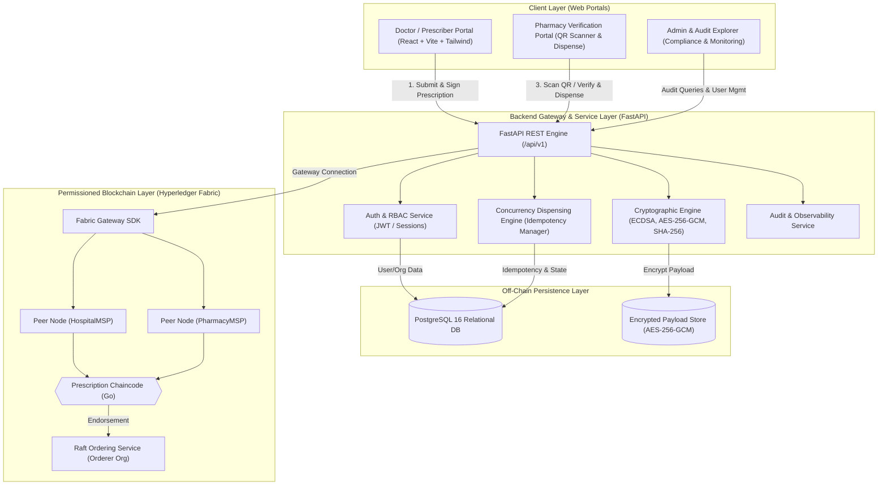
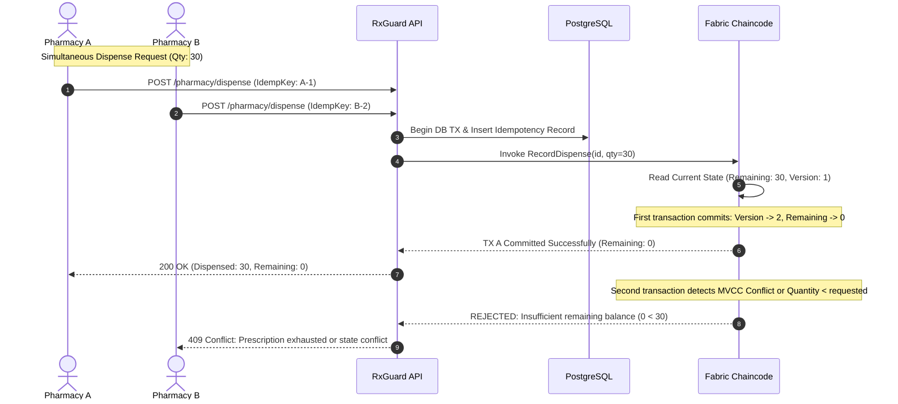

# RxGuard — System Architecture Specification

## 1. Executive Summary & Design Principles

RxGuard is an enterprise-grade healthcare security platform designed to eradicate prescription fraud, alteration, and duplicate dispensing across independent healthcare providers and retail pharmacies.

### Foundational Principles
1. **On-Chain Minimization (Privacy by Design):** Never write identifiable Patient Health Information (PHI) or unencrypted medical payloads to the blockchain ledger.
2. **Blockchain as the Verification Layer:** Hyperledger Fabric acts strictly as a decentralized state engine and tamper-evident audit log for prescription references, cryptographic hashes, lifecycle statuses, and remaining dispensable quantities.
3. **Cryptographic Non-Repudiation:** Prescriptions are signed with asymmetric digital keys (ECDSA / Ed25519) owned by authorized prescribers. The ledger verifies that the issuer was active and authorized at the moment of issuance.
4. **Concurrency Safety:** Dispensing transactions are atomic. Race conditions (e.g., attempting to dispense the remaining balance at two pharmacies simultaneously) are rejected at the smart contract level via Fabric Multi-Version Concurrency Control (MVCC) and database-level idempotency locks.

---

## 2. High-Level Component Topology

---

## 3. On-Chain vs. Off-Chain Data Boundaries

| Attribute | Storage Location | Security / Cryptographic Treatment |
| :--- | :--- | :--- |
| **Prescription ID** | On-Chain & Off-Chain | Opaque UUIDv4 (Non-enumerable) |
| **Payload Hash** | On-Chain & Off-Chain | SHA-256 over Canonical JSON payload |
| **Issuer Public Key / Key ID** | On-Chain & Off-Chain | Registered under HospitalMSP / Prescriber Identity |
| **Digital Signature** | Off-Chain (Checked against On-chain) | ECDSA P-256 / Ed25519 signature |
| **Lifecycle Status** | On-Chain (Authoritative) | Enum: `ISSUED`, `PARTIALLY_DISPENSED`, `FULLY_DISPENSED`, `REVOKED`, `EXPIRED` |
| **Authorized Balance / Refills** | On-Chain (Authoritative) | Integer balance decremented atomically via chaincode |
| **Dispensing Event Log** | On-Chain & Off-Chain | Timestamp, Pharmacy MSP, Dispenser ID, Quantity Dispensed |
| **Patient Full Name / DOB / ID**| Off-Chain Only | Encrypted with AES-256-GCM (Ciphertext + 96-bit Nonce + Tag) |
| **Clinical Notes & Dosage Details**| Off-Chain Only | Encrypted with AES-256-GCM; accessible strictly by authorized pharmacy during verified session |

---

## 4. Cryptographic Protocol Specification

### 4.1 Canonical Serialization
Before hashing or signing, the prescription dictionary is serialized using deterministic rules:
1. Keys sorted alphabetically at all nesting levels.
2. Compact formatting without extraneous whitespaces (`separators=(',', ':')`).
3. UTF-8 encoded byte array.

$$\text{CanonicalBytes} = \text{SerializeCanonicalJSON}(P_{\text{payload}})$$

### 4.2 Payload Integrity Hash
$$\text{PayloadHash} = \text{SHA-256}(\text{CanonicalBytes})$$

### 4.3 Digital Signature Generation
The prescriber's private key $K_{\text{doctor}}^{\text{priv}}$ signs the SHA-256 digest:
$$\sigma = \text{Sign}_{K_{\text{doctor}}^{\text{priv}}}(\text{PayloadHash})$$

### 4.4 Off-Chain Payload Encryption (AES-256-GCM)
The clinical details are encrypted prior to persistence:
1. Generate cryptographically secure random 96-bit (12-byte) Nonce ($N$).
2. Encrypt plaintext payload with Data Encryption Key ($K_{\text{dek}}$) and Associated Data ($AAD = \text{PrescriptionID}$):
$$(C, T) = \text{AES-256-GCM-Encrypt}(K_{\text{dek}}, N, \text{Plaintext}, AAD)$$
3. Envelope: `{"version": 1, "nonce": Base64(N), "ciphertext": Base64(C), "tag": Base64(T)}`.

---

## 5. Hyperledger Fabric Network Topology

### Organizations
1. **HospitalMSP (Prescribing Organization):** Represents healthcare networks, hospitals, and licensed medical practitioners.
2. **PharmacyMSP (Dispensing Organization):** Represents licensed dispensing pharmacies and authorized pharmacists.
3. **OrdererMSP:** Raft-based consensus node maintaining ordered block batches.

### Endorsement Policy
- Issuance: `HospitalMSP.peer` must endorse.
- Dispense: `PharmacyMSP.peer` must endorse.
- Revocation: `HospitalMSP.peer` (original issuer org) must endorse.

---

## 6. Concurrency & Idempotency Strategy

### The Double-Dispensing Race Condition
A patient obtains an issued prescription for 30 tablets. Two pharmacy counters simultaneously scan the QR code and submit a dispense request for 30 tablets.

