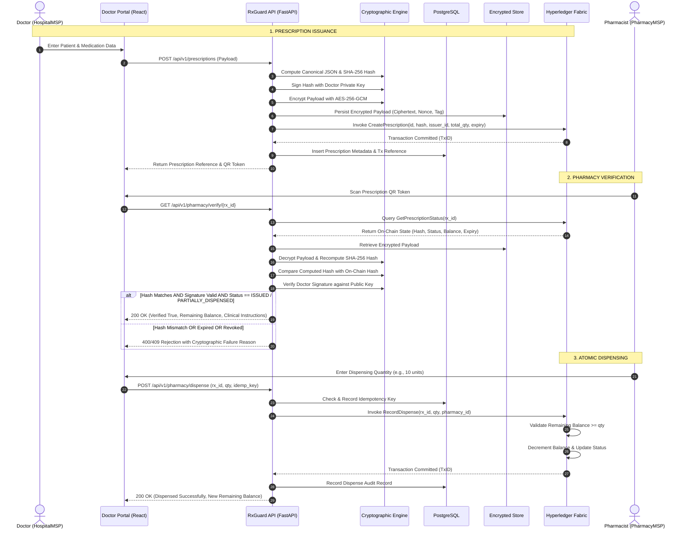

# RxGuard — Data Flow Specification

## 1. End-to-End Prescription Lifecycle Data Flow



---

## 2. Canonical Prescription Payload Schema

Before hashing and digital signing, the prescription must conform to the following schema and be serialized deterministically:

```json
{
  "prescription_id": "7f8b9e12-3456-4abc-9def-0123456789ab",
  "schema_version": "1.0",
  "issuer_organization_id": "ORG-HOSPITAL-01",
  "prescriber_id": "DOC-99482",
  "prescriber_public_key_id": "KEY-DOC-99482-V1",
  "patient_reference_id": "PAT-REF-88319",
  "issued_at": "2026-10-26T12:00:00Z",
  "expires_at": "2026-11-26T12:00:00Z",
  "total_authorized_quantity": 30,
  "allow_partial_dispense": true,
  "max_refills": 1,
  "items": [
    {
      "item_id": "MED-001",
      "medication_code": "NDC-0069-4200",
      "medication_name": "Amoxicillin 500mg",
      "quantity": 30,
      "dosage": "500mg",
      "frequency": "Three times daily with food",
      "duration_days": 10
    }
  ]
}
```

---

## 3. On-Chain Ledger State Schema (Hyperledger Fabric World State)

```json
{
  "doc_type": "prescription_record",
  "prescription_id": "7f8b9e12-3456-4abc-9def-0123456789ab",
  "payload_hash": "e3b0c44298fc1c149afbf4c8996fb92427ae41e4649b934ca495991b7852b855",
  "issuer_organization_id": "HospitalMSP",
  "prescriber_id": "DOC-99482",
  "prescriber_public_key_id": "KEY-DOC-99482-V1",
  "status": "ISSUED",
  "issued_at": "2026-10-26T12:00:00Z",
  "expires_at": "2026-11-26T12:00:00Z",
  "total_authorized_quantity": 30,
  "remaining_quantity": 30,
  "revoked": false,
  "revocation_reason": "",
  "dispense_events": []
}
```
